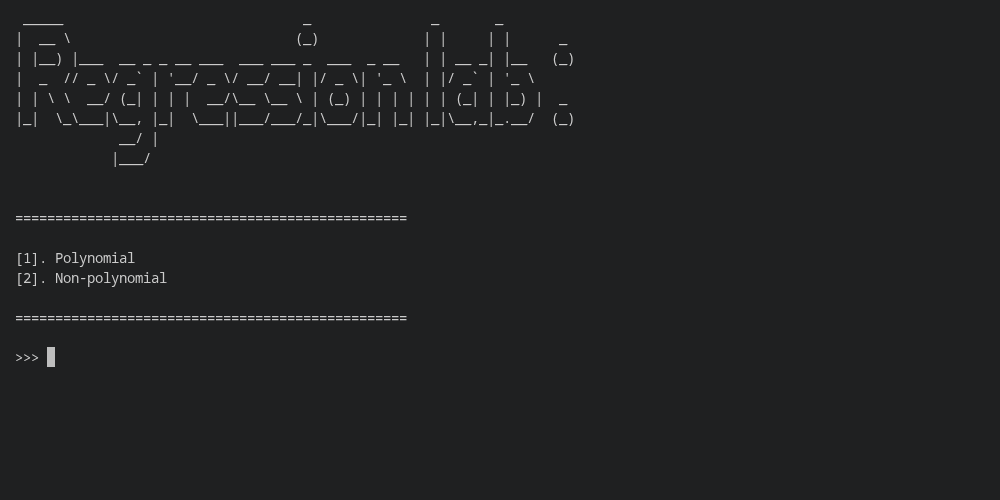

# [Regression_lab](https://github.com/Sina2468/Regression_lab) .   

Easily convert .csv data into a regression chart.

## Installation

1. Download the program 

        git clone https://github.com/Sina2468/Regression_lab.git

* or

    https://github.com/Sina2468/Regression_lab/archive/refs/heads/main.zip

2. Download requirement
        
        pip install -r requirements.txt

## Usage

1. Run **Regression_lab.py** file

2. Choose a chart

3. Choose a Type for regression

## License

[MIT licensed](./LICENSE)
